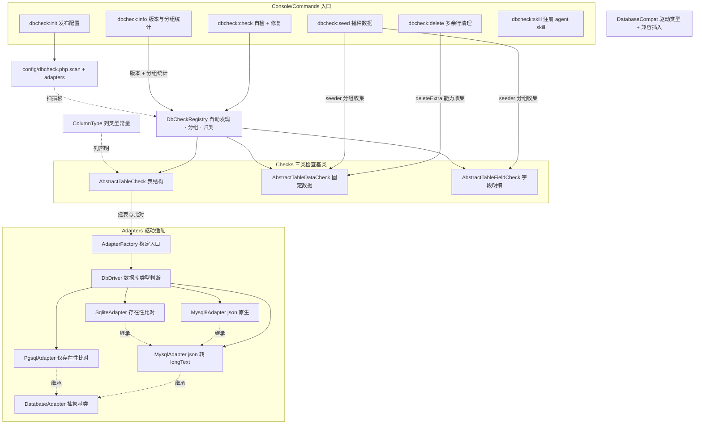

# dbcheck（dongasai/dbcheck）

> 数据库结构/数据自检与修复框架：按表声明「最终结构 + 固定数据」，自动比对实际库差异并驱动修复。
>
> 包类型 `library` · PHP >=7.4 · illuminate 8–13 · 经 composer extra.laravel.providers 自动发现（doctrine/dbal 已从 require 移除：包源码零使用；Laravel 8/9 修改已有列仍需宿主装 dbal——已在 composer `suggest` 声明，较新 Laravel 原生 `change()` 无需）

_初始化：2026-11-01 00:56 · 最近全量校对：2026-11-03（补审计缺口：发现计数/选择器零命中、`--strict`、预览预热 PreviewContext、pretend 异常复位、缺 type/索引声明校验、预览 SQL 字面量保真、测试补齐后；新增 `dbcheck:info` 版本与分组统计）_

## 架构总览

**主链路**：`dbcheck:check` →（可选 `--check=db`：连接/驱动类型/适配器/版本/表数量自检，默认只读）→ 打印发现计数（`DbCheckRegistry::counts()`；**0 个检查器直接 warn + FAILURE**，**选择器零命中（`--group` 拼错/默认集合全空）同样 FAILURE**，避免静默全绿）→ `DbCheckRegistry`（自动发现/过滤）→ `grouped()` 按三类定序（表结构 → 固定数据 → 字段明细；归类异常命令侧捕获为「归类失败」不崩栈）→ 逐检查器 `check()` 报异常项 → 交互确认（`preview()` 以 pretend 模式出 SQL，**pretend 前先经 `PreviewContext` 预热元数据**）→ `fix($key)` 修复 → 复检至全绿；非交互下全部为可选处理项时返回 SUCCESS（`--strict` 才按失败）。

**删除链路**：`dbcheck:delete` 按「能力」（`deleteExtra() = true`）收集 DataCheck（不受分组过滤影响）→ 只取 `data.extra.*` 多余行项 → 交互逐条确认 / `--yes` 免确认 → 按身份等值 DELETE → 复检。

**播种链路**：`dbcheck:seed` 按「分组」（默认 `DbCheckGroup::SEEDER`，`--group=` 可指定任意自定义分组）收集 DataCheck / FieldCheck → 缺行补插（`data.*`）+ 字段回写（`field.*` / `item.*`）→ 复检。seed 只补、delete 只删，二者正交（同一检查器可同时声明 SEEDER 分组与 deleteExtra）。

## 核心概念

### 三类检查

| 类型 | 基类 | check 检查 | fix 修复 |
|------|------|-----------|---------|
| 表结构 | AbstractTableCheck | 表不存在 → 报缺失；存在 → 表编码（声明制）与列/索引和最终结构比对 | 缺失按声明建表（编码可覆盖连接默认）；`CONVERT TO` 修编码；补列、改列、补/同名重建索引；额外项确认后 DROP |
| 固定数据 | AbstractTableDataCheck | 必需数据行是否存在；可选删除验证 deleteExtra() 报未声明的多余行 | 缺行 where + insert（+insertMerge），数组值 json_encode；`data.extra.*` 按身份 JSON 删多余行（默认关，启用即入 delete 分组） |
| 字段明细 | AbstractTableFieldCheck | 声明字段标量值 / JSON 数组项齐全性 | 回写标量、只补缺失数组项 |

### 关键约定（红线）

- **一张表一个检查器**：TableCheck 同时实现 TableSchemaProvider，是该表最终结构的唯一声明处（不存在创建，存在比对差异并修复）。禁止两处维护同一张表定义。
- **异常项 key 命名**：`table` / `table.charset` / `column.<名>` / `index.<名>` / `extra_column.<名>` / `extra_index.<名>` / `data.<标识>` / `data.extra.<身份JSON>` / `field.<标识>.<列>` / `item.<标识>.<列>.<项key>`。fix() 对未知 key 必须 LogicException。
- **分组**：`group()` 返回 null = 常规（默认执行）；非空 = 分组检查（仅 `--group=<名>` / `--all-groups` 触发）。标准分组常量两个：`DELETE`（deleteExtra 能力默认归属）与 `SEEDER`（声明制种子数据）——前者由 `dbcheck:delete`、后者由 `dbcheck:seed` 显式触发。
- **开关**：静态 `$enabled=false` 时自动发现跳过（手动 register() 不受影响）。
- **比对深度由适配器决定**：MySQL/MySQL8 精确比对；PG / SQLite 仅存在性（防误报）。

## 模块索引

| 目录 | 文档 | 职责 |
|------|------|------|
| src/Contracts/ | [AGENTS.md](src/Contracts/AGENTS.md) | 检查器与结构声明契约 |
| src/Checks/ | [AGENTS.md](src/Checks/AGENTS.md) | 三类检查抽象基类（核心） |
| src/Adapters/ | [AGENTS.md](src/Adapters/AGENTS.md) | 数据库类型判断（DbDriver）+ MySQL/MySQL8/PG/SQLite 驱动适配 |
| src/Support/ | [AGENTS.md](src/Support/AGENTS.md) | 注册表（发现/分组/计数）+ 列类型常量 + 数据库兼容工具 + 预览上下文缓存（PreviewContext） |
| src/Console/Commands/ | [AGENTS.md](src/Console/Commands/AGENTS.md) | 六条 artisan 命令（check / delete / seed / init / skill / info） |
| resources/skill/dbcheck/ | —（SKILL.md 即指南） | agent 引导 skill，经 dbcheck:skill 注册到宿主项目 |

## 全局规范

- **PHP 7.4 兼容红线**：composer 约束 `>=7.4`，禁用 8.x 语法（构造器属性提升 / readonly / enum / match 等）。宿主项目跑在 8.2 不代表本包可用。
- **全静态风格**：检查器/适配器/注册表均无状态静态方法；禁实例化、禁依赖注入。
- **中文 PHPDoc 全覆盖**；误用显式抛 LogicException，不用 try 掩盖错误。
- 列声明 `type` **必须显式声明**且用 `ColumnType` 常量，禁裸字符串；缺 `type` 键抛 LogicException（不静默回落 string）；check() 在进入比对前统一校验（PG/SQLite 只做存在性比对时也当场暴露）。
- `indexes()` 必须是「索引名 => [columns, unique]」映射，`columns` 必须是非空列名字符串数组；旧 list + name 形态、裸列数组等一律抛 LogicException（否则会生成 `create index ... ()` 非法 SQL、该表永远修不好）。
- **预览必须与真实修复同口径**：`preview()` 在 pretend 之前经 `PreviewContext::remember()` 预热 fix() 依赖的读（列/索引/判重行/insert_merge 引用行/updated_at 列存在性）——pretend 下 SELECT 恒返回空，不预热会把「改列」预览成「加列」、漏掉索引 drop、item.* 预览误抛「行不存在」、已存在行误出 INSERT；pretend 内抛错时 finally 经 `DatabaseCompat::stopPretending()` 复位（Laravel 8 的 pretend 异常不复位，否则后续写静默跳过）。
- 数据操作经 Schema/DB facade；`preview()` 只返回将要执行的写语句 `{query, bindings}`（绑定值未内联），命令侧 `formatSql()` 内联绑定并排版展示（只替换字符串字面量外的 `?`、不压缩字面量内空白）。

## 宿主项目接入（lamei_shop）

1. `php artisan dbcheck:init` 发布 config/dbcheck.php → **显式定义** `scan` 扫描根（框架无隐式默认；扫描根支持 `*` 匹配模式，本项目一条惯例匹配 `Modules/<星>/DbChecks` 覆盖 ABase/DcatAdmin/全部业务模块，新模块建 DbChecks/ 目录即自动纳入）；驱动适配不做配置硬编码，由 DbDriver 检查判断，例外用 `--adapter=` 运行期覆盖
2. 检查类放 `Modules/<模块>/DbChecks/`，命名 `<表名 StudlyCase>{TableCheck|DataCheck|FieldCheck}`
3. `php artisan dbcheck:skill` 把编写指南注册为 agent skill（交互多选，默认 `.agents/skills`——生态通用惯例）
4. 编写口径以 `resources/skill/dbcheck/SKILL.md` 为准（最终结构为准、迁移文件只作参考、落声明后 `--no-interaction` 复验到全绿）

## 测试与已知缺口

- **tests/ 已建**（2026-11-01 并入并补齐；2026-11-03 补审计缺口用例与选择器零命中保护、新增 dbcheck:info 用例）：Unit 8 只（ColumnType / DbCheckRegistry / DbDriver / TableCheckLogic / MysqlAdapter / FieldCheckLogic / PreviewContext / PreviewSqlFormatting）+ Integration 7 只（SQLite 全链：建表比对修复 / 固定数据 / **删除验证** / 字段明细 / **播种分组** / **命令级 CheckInfoCommand** / **命令级 DbcheckInfoCommand**）+ Fixtures 16 只，**153 用例全绿**。运行：`composer test`，或 `phpunit --bootstrap tests/bootstrap.php tests`（需 standalone vendor——require-dev 含 phpunit 与 illuminate/config；data provider 已改静态写法，phpunit 9.6/11 通用）。phpstudy 默认未开 pdo_sqlite 时用 `php -d extension=pdo_sqlite vendor/bin/phpunit --bootstrap tests/bootstrap.php tests`。
- **宿主全框架 vendor 下跑测**：TestCase 已绑 `db.schema`（全套 Laravel 才有的绑定），最小容器可直接跑全绿；autoload-dev 的 Tests 命名空间在宿主 vendor 需 dump-autoload 刷新或测试引导手动补映射。
- 仍无测试覆盖：CheckInfoCommand 交互确认分支（fixIssue 问答，非交互主链路已被 CheckInfoCommandTest 覆盖）、`--check=db`/`--db-write`/`--fix-flow`/`--connection`/`--adapter` 的命令级用例、MySQL 真实库精确比对与「已存在列 modify」预览（本机测试走 SQLite + FakeAttributeAdapter 模拟）、PgsqlAdapter 真实库路径、未知驱动降级提示（需构造无驱动的自定义连接）。
