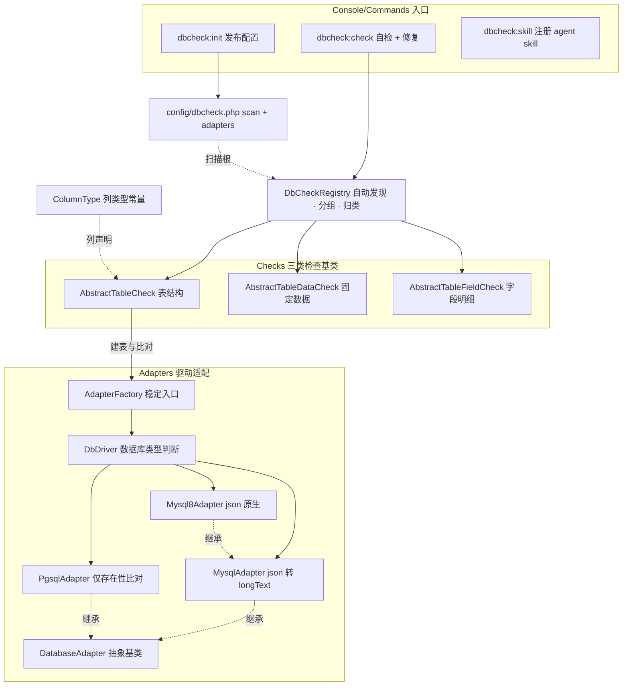

# dbcheck（dongasai/dbcheck）

> 数据库结构/数据自检与修复框架：按表声明「最终结构 + 固定数据」，自动比对实际库差异并驱动修复。
>
> 包类型 `library` · PHP >=7.4 · illuminate 8–12 · doctrine/dbal · 经 composer extra.laravel.providers 自动发现

_初始化：2026-11-01 00:56 · 全量扫描 21/21 文件_

## 架构总览

**主链路**：`dbcheck:check` → `DbCheckRegistry`（自动发现/过滤）→ `grouped()` 按三类定序（表结构 → 固定数据 → 字段明细）→ 逐检查器 `check()` 报异常项 → 交互确认（`preview()` 以 pretend 模式出 SQL）→ `fix($key)` 修复 → 复检至全绿。

## 核心概念

### 三类检查

| 类型 | 基类 | check 检查 | fix 修复 |
|------|------|-----------|---------|
| 表结构 | AbstractTableCheck | 表不存在 → 报缺失；存在 → 表编码（声明制）与列/索引和最终结构比对 | 缺失按声明建表（编码可覆盖连接默认）；`CONVERT TO` 修编码；补列、改列、补/同名重建索引；额外项确认后 DROP |
| 固定数据 | AbstractTableDataCheck | 必需数据行是否存在 | where + insert（+insertMerge），数组值 json_encode |
| 字段明细 | AbstractTableFieldCheck | 声明字段标量值 / JSON 数组项齐全性 | 回写标量、只补缺失数组项 |

### 关键约定（红线）

- **一张表一个检查器**：TableCheck 同时实现 TableSchemaProvider，是该表最终结构的唯一声明处（不存在创建，存在比对差异并修复）。禁止两处维护同一张表定义。
- **异常项 key 命名**：`table` / `table.charset` / `column.<名>` / `index.<名>` / `extra_column.<名>` / `extra_index.<名>` / `data.<标识>` / `field.<标识>.<列>` / `item.<标识>.<列>.<项key>`。fix() 对未知 key 必须 LogicException。
- **分组**：`group()` 返回 null = 常规（默认执行）；非空 = 分组检查（仅 `--group=<名>` / `--all-groups` 触发）。「seeder」语义 = 执行某分组的 row/field 检查。
- **开关**：静态 `$enabled=false` 时自动发现跳过（手动 register() 不受影响）。
- **比对深度由适配器决定**：MySQL/MySQL8 精确比对；PG 仅存在性（防误报）。

## 模块索引

| 目录 | 文档 | 职责 |
|------|------|------|
| src/Contracts/ | [AGENTS.md](src/Contracts/AGENTS.md) | 检查器与结构声明契约 |
| src/Checks/ | [AGENTS.md](src/Checks/AGENTS.md) | 三类检查抽象基类（核心） |
| src/Adapters/ | [AGENTS.md](src/Adapters/AGENTS.md) | 数据库类型判断（DbDriver）+ MySQL/MySQL8/PG 驱动适配 |
| src/Support/ | [AGENTS.md](src/Support/AGENTS.md) | 注册表 + 列类型常量 |
| src/Console/Commands/ | [AGENTS.md](src/Console/Commands/AGENTS.md) | 三条 artisan 命令 |
| resources/skill/dbcheck/ | —（SKILL.md 即指南） | agent 引导 skill，经 dbcheck:skill 注册到宿主项目 |

## 全局规范

- **PHP 7.4 兼容红线**：composer 约束 `>=7.4`，禁用 8.x 语法（构造器属性提升 / readonly / enum / match 等）。宿主项目跑在 8.2 不代表本包可用。
- **全静态风格**：检查器/适配器/注册表均无状态静态方法；禁实例化、禁依赖注入。
- **中文 PHPDoc 全覆盖**；误用显式抛 LogicException，不用 try 掩盖错误。
- 列声明 `type` 必须用 `ColumnType` 常量，禁裸字符串。
- 数据操作经 Schema/DB facade；`preview()` 只返回写 SQL 且内联绑定值。

## 宿主项目接入（lamei_shop）

1. `php artisan dbcheck:init` 发布 config/dbcheck.php → **显式定义** `scan` 扫描根（框架无隐式默认；包模板默认预置 app/DbChecks 常规根，本项目挂 `Modules/ABase/DbChecks`（Laravel 框架表）与 `Modules/DcatAdmin/DbChecks`（admin_* 后台表））；驱动适配不做配置硬编码，由 DbDriver 检查判断，例外用 `--adapter=` 运行期覆盖
2. 检查类放 `Modules/<模块>/DbChecks/`，命名 `<表名 StudlyCase>{TableCheck|DataCheck|FieldCheck}`
3. `php artisan dbcheck:skill` 把编写指南注册为 agent skill（交互多选，默认 `.agent/skills`）
4. 编写口径以 `resources/skill/dbcheck/SKILL.md` 为准（最终结构为准、迁移文件只作参考、落声明后 `--no-interaction` 复验到全绿）

## 测试与已知缺口

- **本包无 Tests 目录**（零自动化测试）——建议补：ColumnType / DbCheckRegistry 单测 + 四基类 sqlite 集成测。
- 签名级覆盖、未逐行精读：AbstractTableCheck::check()/fix() 实现细节、MysqlAdapter::actualIndexes()、CheckInfoCommand 交互主循环 handle()。
